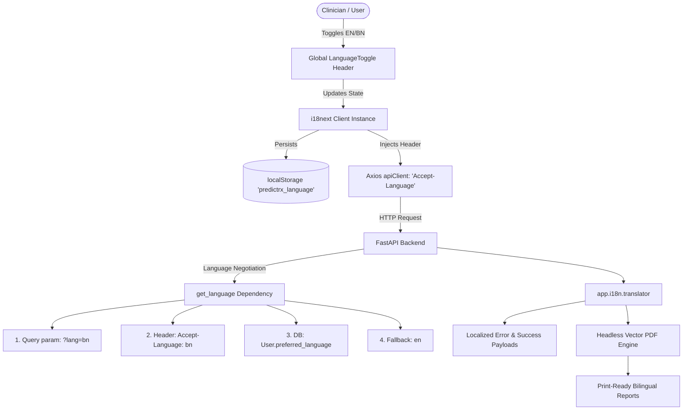

# PredictRx-AI — Bilingual (Bangla & English) Internationalization (i18n) Architecture

## 1. System Overview

PredictRx-AI implements an end-to-end bilingual clinical decision support architecture supporting:
1. **English (`en`)** — Default system language
2. **বাংলা (`bn`)** — Secondary official language

The internationalization system spans across the complete stack:
- **Client Tier**: React 18 + Vite, `i18next`, `react-i18next`, `i18next-browser-languagedetector`, Tailwind CSS typography with `Inter` & `Hind Siliguri`.
- **API Tier**: FastAPI centralized i18n translation service (`app.i18n.translator`), HTTP RFC 2616 language negotiation, stable machine-readable error codes.
- **Data Tier**: PostgreSQL / SQLite Alembic migration adding `preferred_language` to the `users` table, synced via `PATCH /api/v1/auth/me/preferences`.
- **Reporting Tier**: Headless Chromium / Edge print pipeline generating vector PDFs with embedded Bangla Unicode typography.

---

## 2. Architecture & Components



---

## 3. Frontend Internationalization

### 3.1 Namespace Structure
All user-facing strings are decoupled into 11 distinct clinical domain namespaces under `frontend/src/i18n/locales/`:

```
frontend/src/i18n/
├── config.ts                    # i18next configuration & resources
├── index.ts                     # Public API: setLanguage, getCurrentLanguage
└── locales/
    ├── en/
    │   ├── common.json          # App name, actions, status, pagination, modal
    │   ├── navigation.json      # Sidebar, header breadcrumbs, notifications
    │   ├── dashboard.json       # KPI metrics, surveillance charts, quick actions
    │   ├── analysis.json        # OCR upload, patient context form, findings
    │   ├── prescriptions.json   # Rx filters, status tags, table headers
    │   ├── patients.json        # Patient directory, vitals, lab indices
    │   ├── drugs.json           # DGDA brand catalogue, therapeutic classes
    │   ├── interactions.json    # Drug collision center, pair screener
    │   ├── reports.json         # Clinical report viewer, PDF export labels
    │   ├── settings.json        # Profile, language preference, theme, CDSS config
    │   └── validation.json      # Form & input validation feedback
    └── bn/                      # Matching 11 namespaces in fluent medical বাংলা
```

### 3.2 Global Language Switcher
- **Component**: `frontend/src/components/layout/LanguageToggle.tsx`
- **Location**: Top navigation bar, visible on all routes and viewports.
- **Accessibility**: Includes `role="group"`, `aria-label="Select Language"`, `aria-pressed` state indicators, and keyboard accessibility.
- **Persistence**: Instant switch without reload, persisting in `localStorage` under `predictrx_language`.
- **HTML Document Sync**: Dynamically updates `<html lang="en">` or `<html lang="bn">`.

### 3.3 Typography & Font Rendering
- **English**: `Inter` (weights 400, 500, 600, 700).
- **Bangla**: `Hind Siliguri` (weights 400, 500, 600, 700) loaded via Google Fonts with zero mojibake or glyph clipping.
- **Line Heights & Text Flow**: Tailored `html[lang="bn"] body { line-height: 1.6; }` to accommodate Bengali conjunct ascenders and descenders.

### 3.4 Locale-Aware Formatting (`frontend/src/lib/utils.ts`)
Formatting helpers wrap JavaScript standard `Intl` APIs:
- `formatDate(date, lang)`: Uses `bn-BD` or `en-US` locale conventions.
- `formatNumber(number, lang)`: Converts digits to Bengali numerals (`১২৩৪৫`) in Bangla mode.
- `formatPercent(value, lang)`: Formats numbers with locale percent symbols (`৮৪%`).
- `formatCurrency(amount, lang)`: Formats monetary figures in Bangladeshi Taka (`৳ ৫০০` / `BDT 500`).
- `toBanglaDigits(input)`: Safe utility mapping `[0-9]` to `[০-৯]` without altering punctuation or Latin unit strings.

---

## 4. Backend Internationalization (FastAPI)

### 4.1 Centralized Translator (`backend/app/i18n/`)
The singleton `translator` provides:
- Dot-delimited key lookup (e.g., `translator.t("auth.invalid_credentials", lang="bn")`).
- Interpolation token formatting (e.g., `{prescription_id}`, `{field}`).
- Safe English fallback if a translation key is missing.
- RFC 2616 `Accept-Language` quality weighting parsing (e.g., `bn-BD,bn;q=0.9,en;q=0.8`).

### 4.2 Language Negotiation Order
1. **Explicit Query Parameter**: `?lang=en` or `?lang=bn` (highest priority for exports/downloads).
2. **HTTP Header**: `Accept-Language: bn` (sent by default by the frontend Axios interceptor).
3. **User Profile**: `User.preferred_language` stored in database.
4. **Default System Fallback**: `en`.

### 4.3 Stable API Contract & Error Structure
Machine-readable error codes and database field names remain unaltered:

```json
{
  "code": "REQUEST_VALIDATION_ERROR",
  "message": "অনুরোধের তথ্য সঠিক নয়। অনুগ্রহ করে পুনরায় পরীক্ষা করুন।",
  "details": [
    {
      "field": "age",
      "issue": "বয়স অবশ্যই ১ থেকে ১২০ এর মধ্যে হতে হবে"
    }
  ]
}
```

---

## 5. Database Schema & User Preferences

### 5.1 Migration
Alembic migration `b7a2d3e4f501_add_user_preferred_language.py` adds:
- Column: `preferred_language VARCHAR(5) NOT NULL DEFAULT 'en'`
- Check Constraint / Validation: `en` | `bn`

### 5.2 Endpoint
`PATCH /api/v1/auth/me/preferences`
- **Request Body**: `{"preferred_language": "bn"}`
- **Response**: `UserResponse` with updated preference.

---

## 6. Clinical Safety & Medical Terminology Rules

To prevent clinical misinterpretation:
1. **Generic Drug Names Remain in English**: e.g., *Ketorolac Tromethamine*, *Ramipril*, *Olmesartan*, *Metformin*.
2. **International Clinical Acronyms Remain Standardized**: e.g., `eGFR`, `HbA1c`, `INR`, `ECG`, `CKD`, `AKI`.
3. **Scientific Units Remain Standardized**: e.g., `mg`, `mL/min/1.73m²`, `mg/dL`, `mmol/L`.
4. **Clinical Guidelines & Citations**: Official titles such as *KDIGO 2024 Clinical Practice Guideline*, *British National Formulary (BNF 86)*, and DOI links are never translated or modified.
5. **No AI Translation of Prescriptions**: Translations rely on curated, clinically reviewed dictionaries rather than unconstrained runtime LLM generation.

---

## 7. Bilingual PDF Generation

- **Engine**: Headless Chromium / Edge via `app.services.pdf_report_service.PdfReportService`.
- **Endpoint**: `GET /api/v1/reports/{prescription_id}/pdf?lang=en|bn`
- **Fonts**: Embedded `Hind Siliguri` + `Inter` with print CSS pagination (`@page { size: A4; margin: 12mm 14mm; }`).
- **Clinical Content**: Generates full clinical summary, patient renal lab metrics, DGDA normalized medicines table, drug-drug collision analysis, SHAP feature drivers, and BMDC clinician sign-off box.

---

## 8. Verification & Test Suite

### Frontend Vitest Suite
- Command: `cd frontend; npm test`
- Results: **31 passed** (7 test suites, 0 failures)
  - `src/test/i18n.test.tsx` (13 tests): Language toggle, localStorage persistence, locale formatting, translation resolution, accessibility.
  - `src/test/PrescriptionAnalysis.test.tsx` (4 tests)
  - `src/test/DrugInteraction.test.tsx` (3 tests)
  - `src/test/Dashboard.test.tsx` (3 tests)
  - `src/test/ShapChart.test.tsx` (3 tests)
  - `src/test/BanglaCompanion.test.tsx` (4 tests)
  - `src/test/MedicalSafety.test.tsx` (1 test)

### Backend Pytest Suite
- Command: `cd backend; .\.venv\Scripts\pytest`
- Results: **41 passed** (10 test suites, 0 failures)
  - `tests/test_i18n.py` (5 tests): Direct translator resolution, Accept-Language negotiation, user preference PATCH & persistence, localized 404/validation errors, and bilingual PDF rendering.
