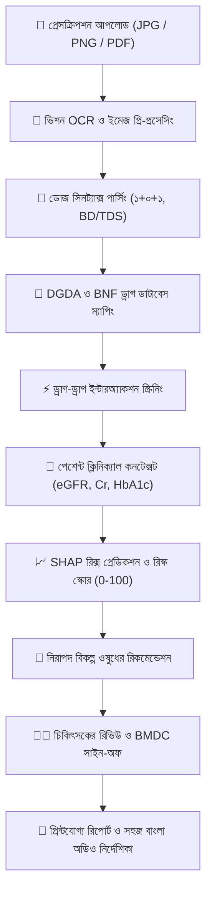

# 🩺 PredictRx-AI — Clinical Decision Support System (CDSS)
> **AI-Powered Prescription OCR, Explainable Safety Analysis & Pharmacovigilance Platform**  
> *Designed for Bangladesh Clinical Ecosystem & Global Healthcare Workflows*

---

## 📌 ১. ওভারভিউ (Overview & Mission)

**PredictRx-AI** একটি আধুনিক, এআই-চালিত **Clinical Decision Support System (CDSS)**। এটি ডাক্তার ও স্বাস্থ্যকর্মীদের প্রেসক্রিপশন নিরীক্ষা করতে, ওষুধের ক্ষতিকর মিথস্ক্রিয়া (Drug-Drug Interactions) শনাক্ত করতে, রোগীর কিডনি-লিভার সক্ষমতার সাথে ওষুধের মাত্রা যাচাই করতে এবং রোগীদের জন্য সহজ বাংলায় নির্দেশিকা তৈরি করতে সহায়তা করে।

এটি কোনো জেনেরিক চ্যাটবট নয়—এটি একটি **ক্লিনিক্যাল ইন্টেলিজেন্স প্ল্যাটফর্ম** যা "AI reads, deterministic rules decide" আর্কিটেকচার মেনে কাজ করে।

---

## 🚀 ২. মূল কাজ কী কী? (Key Features)

| ফিচার | বিবরণ |
|---|---|
| **📸 প্রেসক্রিপশন ভিশন OCR** | বাংলা/ইংরেজি হস্তলিখিত বা প্রিন্ট করা প্রেসক্রিপশনের ছবি থেকে নির্ভুলভাবে ওষুধের নাম, শক্তি, মাত্রা ও সময়সূচি এক্সট্রাক্ট করা। |
| **🇧🇩 বাংলাদেশি ব্র্যান্ড নরম্যালাইজেশন** | বাংলাদেশের স্থানীয় ব্র্যান্ড নামকে আন্তর্জাতিক জেনেরিক নামে রূপান্তর (যেমন: *Bizoran 5/20* → *Amlodipine + Olmesartan*, *Rolac 10* → *Ketorolac*)। |
| **⏱️ ডোজ সিনট্যাক্স ও সিলিং ভ্যালিডেশন** | বাংলাদেশি প্রচলিত ফর্ম্যাট (`১+০+১`, `1-0-1`, `খাবার আগে/পরে`) স্বয়ংক্রিয়ভাবে পার্স করে এবং ড্রাগ সিলিং চেক করে (যেমন: রোলাক সর্বোচ্চ ৫ দিন অনুমোদিত, প্রেসক্রিপশনে ১৪ দিন থাকলে লাল সতর্কবার্তা দেবে)। |
| **⚠️ ড্রাগ-ড্রাগ ও ড্রাগ-ডিজিজ মিথস্ক্রিয়া** | রোগীর বিদ্যমান রোগ (যেমন: CKD Stage 3, ডায়াবেটিস) এবং চলমান ওষুধের সাথে প্রেসক্রিপশনের ওষুধের বিপজ্জনক সংঘর্ষ (যেমন: ARB + Ketorolac "Triple Whammy" নেফ্রোটক্সিক ঝুঁকি) শনাক্তকরণ। |
| **📊 বোধগম্য এক্সপ্লেইনেবল এআই (SHAP XAI)** | Recharts ওয়াটারফল চার্টের মাধ্যমে কোনো লুকোচুরি ছাড়া দেখানো হয় কোন কোন ফ্যাক্টরের কারণে রোগীর ঝুঁকি বেড়েছে (যেমন: কিডনি eGFR +28%, অতিরিক্ত মেয়াদ +42%)। |
| **🔄 নিরাপদ বিকল্প ওষুধের প্রস্তাবনা** | ঝুঁকিপূর্ণ ওষুধের বদলে কিডনি ও লিভারের জন্য নিরাপদ বিকল্প সাজেশন (যেমন: Ketorolac এর বদলে Paracetamol / Napa Extend 665mg)। |
| **🇧🇩 সহজ বাংলা রোগী নির্দেশিকা (Bangla Companion)** | রোগীদের জন্য সম্পূর্ণ বাংলায় ওষুধ খাওয়ার সময়সূচি, জরুরি সতর্কতা এবং ব্রাউজার টেক্সট-টু-স্পিচ (TTS) অডিও দিয়ে পড়ে শোনানোর সুবিধা। |
| **👨‍⚕️ চিকিৎসকের ডিজিটাল সাইন-অফ ও অডিট** | নিবন্ধিত চিকিৎসকের BMDC নম্বর, সিদ্ধান্ত (`APPROVED`, `MODIFIED`, `REJECTED`) এবং নোটসহ অফিশিয়াল প্রিন্টযোগ্য ক্লিনিক্যাল অডিট রিপোর্ট। |

---

## ⚙️ ৩. যেভাবে কাজ করে (How It Works — Technical Pipeline)



### কাজের ধাপসমূহ:
1. **ইনপুট গ্রহণ:** ডাক্তার বা সহকারী প্রেসক্রিপশনের ছবি আপলোড করেন এবং রোগীর প্রাথমিক তথ্য (বয়স, ক্রিয়েটিনিন, eGFR, ডায়াবেটিস বা প্রেশার) প্রদান করেন।
2. **Deterministic Rules Engine:** এআই কেবল ছবি থেকে টেক্সট পড়ে। কিন্তু কোনো ওষুধ ঝুঁকিপূর্ণ কিনা বা মাত্রাতিরিক্ত কিনা—তা নির্ধারিত হয় নিখুঁত পাইথন রুলস এবং DGDA/BNF ক্লিনিক্যাল গাইডলাইন অনুযায়ী।
3. **ক্লিনিক্যাল রিস্ক অ্যানালাইসিস:** রোগী ভিত্তিক ঝুঁকি গণনা করে দেখানো হয় (যেমন: AKI ঝুঁকি ৮৪%, জিআই ব্লিডিং ঝুঁকি ৬৮%)।
4. **দ্বিমুখী আউটপুট:**
   - **ডাক্তারদের জন্য:** আন্তর্জাতিক মানদণ্ডের ক্লিনিক্যাল অডিট রিপোর্ট।
   - **রোগীদের জন্য:** মাতৃভাষা বাংলায় খাবার নিয়ম ও অডিও স্পিচ কার্ড।

---

## 🛠️ ৪. প্রযুক্তিগত কাঠামো (Technology Stack)

- **Frontend Core:** React 19, TypeScript, Vite
- **Styling & Design System:** Tailwind CSS, Radix UI Primitives, Lucide Icons
- **Data Visualization:** Recharts (SHAP Waterfall, Risk Distribution Donut & Activity Charts)
- **Forms & Validation:** React Hook Form, Zod
- **Routing & Query:** React Router (Lazy-loaded code-splitting), TanStack Query
- **Notifications:** Sonner
- **Testing:** Vitest, React Testing Library, JSDOM (16 Automated Tests Passing)
- **Backend Integration:** Centralized Axios client with automatic Safe Mock Adapter fallback

---

## 📂 ৫. প্রজেক্ট ফোল্ডার স্ট্রাকচার (Project Structure)

```
frontend/
├── public/                 # Favicon ও স্ট্যাটিক অ্যাসেটস
├── src/
│   ├── app/                # App কম্পোনেন্ট, প্রোভাইডার ও লেজি-লোডেড রাউটার
│   ├── components/
│   │   ├── clinical/       # বাংলা কম্প্যানিয়ন, SHAP চার্ট, রিস্ক গজ, ডক্টর রিভিউ মোডাল
│   │   ├── layout/         # রেসপনসিভ সাইডবার, টপ ন্যাভিগেশন, অ্যাপ শেল
│   │   └── ui/             # রিইউজেবল বাটন, কার্ড, ব্যাজ, ডায়ালগ, টেবিল, ইনপুট ইত্যাদি
│   ├── constants/          # ডেমো পেশেন্ট ডাটা, ইন্টারঅ্যাকশন ও সেফটি ডিসক্লেইমার
│   ├── features/
│   │   ├── bangla-companion/       # সহজ বাংলা রোগী নির্দেশিকা পেজ (/bangla-companion)
│   │   ├── dashboard/              # ক্লিনিক্যাল ওভারভিউ ড্যাশবোর্ড (/dashboard)
│   │   ├── drug-interactions/      # ড্রাগ ইন্টারঅ্যাকশন সেন্টার (/drug-interactions)
│   │   ├── patients/               # পেশেন্ট ডিরেক্টরি ও প্রোফাইল (/patients)
│   │   ├── prescription-analysis/  # প্রেসক্রিপশন আপলোড ও ৯-ধাপের পাইপলাইন (/analyze)
│   │   ├── prescriptions/          # প্রেসক্রিপশন হিস্ট্রি ও অডিট ট্রেইল (/prescriptions)
│   │   ├── reports/                # প্রিন্টযোগ্য ক্লিনিক্যাল অডিট রিপোর্ট (/reports/:id)
│   │   ├── risk-analysis/          # বোধগম্য SHAP রিস্ক অ্যানালাইসিস (/risk-analysis/:id)
│   │   └── settings/               # থিম, BMDC প্রোফাইল ও FastAPI সংযোগ সেটিংস
│   ├── lib/                # Tailwind Merge (cn) ও ডেট ইউটিলিটি
│   ├── services/           # সেন্ট্রালাইজড এপিআই ক্লায়েন্ট ও মক সার্ভিস অ্যাডাপ্টার
│   ├── test/               # Vitest টেস্ট সুইট ও স্পিচ মক
│   └── types/              # স্ট্রং টাইপস্ক্রিপ্ট ইন্টারফেসসমূহ
├── package.json
├── tailwind.config.js
├── tsconfig.app.json
└── vite.config.ts
```

---

## 🚦 ৬. পেজ এবং রুটসমূহ (Available Pages & Routes)

| রুট | পেজ | বিবরণ |
|---|---|---|
| `/dashboard` | **Dashboard** | প্রেসক্রিপশন নিরীক্ষার ওভারভিউ, রিস্ক ডিস্ট্রিবিউশন চার্ট এবং লাইভ অ্যালার্ট। |
| `/analyze` | **Analyze Prescription** | প্রেসক্রিপশন আপলোড, রোগী প্রোফাইল ফর্ম, ৯-ধাপের মূল্যায়ন এবং ফলাফল। |
| `/prescriptions` | **Prescription Records** | সকল বিশ্লেষিত প্রেসক্রিপশনের ফিল্টারযোগ্য হিস্ট্রি ও রেকর্ড। |
| `/patients` | **Patient Directory** | রোগীদের তালিকা, eGFR/Creatinine মাত্রা ও পূর্বের প্রেসক্রিপশন। |
| `/patients/:id` | **Patient Profile** | নির্দিষ্ট রোগীর দীর্ঘমেয়াদি চিকিৎসা ও স্বাস্থ্য রেকর্ড। |
| `/drug-interactions` | **Drug Interactions** | ওষুধের ক্ষতিকর মিথস্ক্রিয়া অনুসন্ধান এবং তাৎক্ষণিক ড্রাগ-পেয়ার স্ক্রিনার। |
| `/risk-analysis/:id` | **Clinical Risk & SHAP** | Recharts ওয়াটারফল চার্ট ও কারণসহ এআই রিস্ক স্কোর বিশ্লেষণ। |
| `/reports/:id` | **Clinical Reports** | প্রিন্ট-ফ্রেন্ডলি অফিশিয়াল মেডিকেল রিপোর্ট ও EHR JSON এক্সপোর্ট। |
| `/bangla-companion` | **Bangla Companion** | রোগীদের জন্য বাংলায় নির্দেশিকা, বড় সতর্কবার্তা ও অডিও স্পিচ সিন্থেসিস। |
| `/settings` | **System Settings** | ডার্ক/লাইট মোড, BMDC লাইসেন্স ও FastAPI ব্যাকএন্ড কানেকশন স্ট্যাটাস। |

---

## 💻 ৭. কিভাবে চালাবেন? (Getting Started)

### ১. ডিপেন্ডেন্সি ইনস্টল করুন:
```bash
cd frontend
npm install
```

### ২. এনভায়রনমেন্ট ভ্যারিয়েবল কনফিগার করুন:
```bash
# .env ফাইল তৈরি করুন
cp .env.example .env
```
*(ডিফল্টভাবে ব্যাকএন্ড অফলাইনে থাকলে ফ্রন্টএন্ড স্বয়ংক্রিয় Safe Demo Mock মোডে চলবে, কোনো ক্র্যাশ করবে না)*

### ৩. ডেভেলপমেন্ট সার্ভার চালু করুন:
```bash
npm run dev
```
ব্রাউজারে ওপেন করুন: `http://localhost:5173`

### ৪. অটোমেটেড টেস্ট চালান:
```bash
npm test
```
*(১৬টি টেস্ট কেস সফলভাবে রান হবে)*

### ৫. প্রোডাকশন বিল্ড তৈরি করুন:
```bash
npm run build
```

---

## 🎯 ৮. হ্যাকাথন ডেমো সিনারিও (Demo Scenario)

হ্যাকাথন বা জাজদের প্রেজেন্টেশনের জন্য এক ক্লিকেই ডেমো ডেটা লোড করার ব্যবস্থা রয়েছে:
1. **Analyze Prescription** (`/analyze`) পেজে যান।
2. উপরে থাকা **"Load Hackathon Demo Scenario (CKD 3 / Ketorolac)"** বাটনে ক্লিক করুন।
3. স্বয়ংক্রিয়ভাবে ৬২ বছর বয়সী কিডনি রোগীর তথ্য (eGFR 34.5, Creatinine 2.1) এবং প্রেসক্রিপশনে *Bizoran 5/20* ও *Rolac 10* (১৪ দিন) পূরণ হয়ে যাবে।
4. **"Run Full CDSS Safety Evaluation"** বাটনে ক্লিক করলেই মুহূর্তের মধ্যে এআই রুলস রোলাকের অতিরিক্ত মেয়াদ ও কিডনি ঝুঁকি ধরে ফেলবে, নিরাপদ বিকল্প হিসেবে *Napa Extend* সুপারিশ করবে এবং বাংলায় রোগীকে অডিও নির্দেশিকা শুনিয়ে দেবে।

---

## ⚖️ ৯. মেডিকেল ও আইনি ডিসক্লেইমার (Clinical Safety Notice)

> **PredictRx-AI একটি এআই-সহায়তাকারী ক্লিনিক্যাল ডিসিশন সাপোর্ট টুল (CDSS)। এটি কোনো অবস্থাতেই একজন রেজিস্টার্ড চিকিৎসকের পেশাদার মূল্যায়নের বিকল্প নয়। ওষুধের পরিবর্তন, সংযোজন বা ডোজ সমন্বয়ের চূড়ান্ত সিদ্ধান্ত অবশ্যই সংশ্লিষ্ট চিকিৎসকের দ্বারা অনুমোদিত হতে হবে।**
